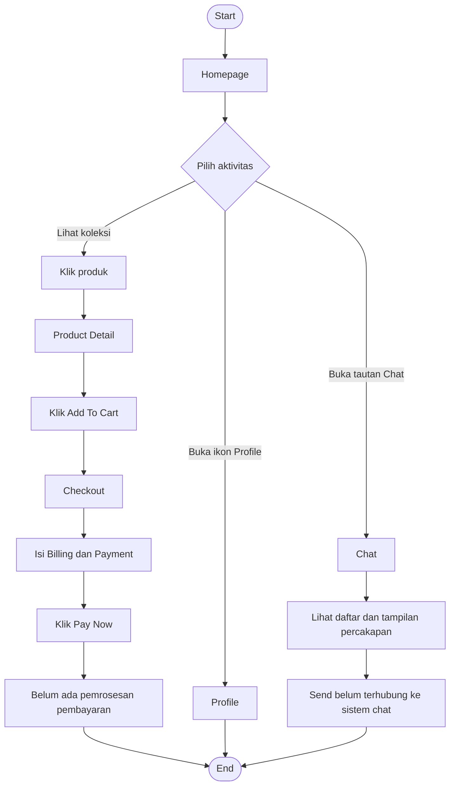
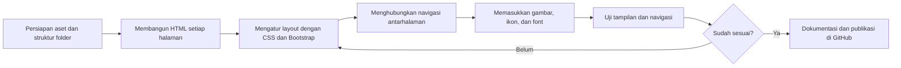

[README.md](https://github.com/user-attachments/files/34613318/README.md)# PANDYNDY STUDIO

**PANDYNDY STUDIO** adalah proyek *front-end website prototype* untuk toko pakaian online. Website ini menampilkan katalog koleksi pakaian, detail produk, halaman checkout, tampilan percakapan dengan customer, dan halaman profil pengguna.

Proyek ini dibuat menggunakan HTML, CSS, dan Bootstrap 5.3.3. Fokus utamanya adalah membangun tampilan dan alur dasar pengalaman belanja online sebelum dikembangkan menjadi aplikasi e-commerce yang terhubung dengan backend.

> **Project status:** Front-end prototype / static website. Data produk, percakapan, profil, dan proses pembayaran pada kode yang diberikan masih bersifat statis.

## Project Overview

| Informasi | Detail |
|---|---|
| Nama proyek | PANDYNDY STUDIO |
| Jenis proyek | Website e-commerce pakaian, front-end prototype |
| Bahasa | HTML5, CSS3 |
| CSS framework | Bootstrap 5.3.3 |
| Font | Helvetica, dengan fallback Arial dan sans-serif |
| JavaScript | Bootstrap Bundle dari CDN. Belum terdapat logika JavaScript khusus untuk transaksi atau chat |
| Halaman utama | Homepage, Product Detail, Checkout, Chat, Profile |

## Tujuan Proyek

1. Menampilkan koleksi pakaian dan kategori produk melalui halaman utama.
2. Memberikan informasi produk, deskripsi, ukuran, dan pilihan warna.
3. Menyediakan tampilan checkout untuk data pelanggan dan ringkasan pesanan.
4. Menyediakan rancangan antarmuka chat untuk komunikasi pelanggan.
5. Menyediakan halaman profil pengguna sebagai bagian dari rancangan website toko online.

## Teknologi yang Digunakan

- **HTML5** digunakan untuk menyusun struktur halaman.
- **CSS3** digunakan untuk mengatur layout, warna, tipografi, dan komponen visual.
- **Bootstrap 5.3.3** digunakan melalui CDN untuk membantu layout dan utility class seperti `d-flex`, `gap`, `justify-content-center`, dan `align-items-center`.
- **Helvetica** digunakan sebagai font utama melalui `@font-face`.
- **SVG dan PNG** digunakan untuk logo, ikon, ilustrasi fitur, kategori, dan gambar produk.

## Struktur Halaman

### 1. Homepage (`Homepage.html`)

Halaman utama yang menjadi pintu masuk pengguna ke website. Konten yang ditampilkan meliputi:

- Announcement bar untuk informasi peluncuran koleksi terbaru.
- Navbar dan ikon navigasi.
- Hero section bertema *Summer Outfit*.
- Bagian New Collection untuk menampilkan produk.
- Bagian keunggulan layanan (*Why You'll Love Shopping With Us*).
- Bagian kategori gaya, seperti KPOP Style, Y2K Style, dan Sport Style.

### 2. Product Detail (`Product.html`)

Halaman detail produk yang menampilkan informasi produk terpilih. Konten yang tersedia meliputi:

- Gambar produk.
- Nama dan harga produk.
- Deskripsi produk.
- Pilihan ukuran dan warna.
- Tombol **Add To Cart** yang mengarahkan pengguna ke `Checkout.html`.
- Bagian rekomendasi produk melalui *You Might Also Like*.

### 3. Checkout (`Checkout.html`)

Halaman untuk mengisi informasi pelanggan dan melihat ringkasan pesanan. Halaman ini memiliki dua bagian utama:

- **Billing:** Full Name, Address, dan Phone Number.
- **Payment:** input kartu, tanggal kedaluwarsa, dan CVV.
- **Order Summary:** daftar produk, subtotal, diskon, pajak, dan total.
- Tombol **Pay Now** sebagai elemen antarmuka pembayaran.

Pada implementasi saat ini, tombol Pay Now belum terhubung ke payment gateway atau sistem pemrosesan transaksi.

### 4. Chat (`Chat.html`)

Halaman antarmuka percakapan pelanggan. Layout dibagi menjadi dua bagian:

- Panel kiri berisi kolom pencarian dan daftar percakapan.
- Panel kanan berisi nama kontak, riwayat pesan, kolom penulisan pesan, dan tombol Send.

Data percakapan masih ditulis langsung pada HTML. Search, pemilihan percakapan, dan tombol Send belum memiliki fungsi pengolahan pesan.

### 5. Profile (`profile.html`)

Halaman profil pengguna. Pada kode yang tersedia, halaman ini menampilkan aset `profile.svg` sebagai konten utama. Informasi profil dan fitur pengeditan akun belum diimplementasikan sebagai komponen HTML interaktif.

## Preview Website

Screenshot berikut merupakan **render preview berdasarkan struktur dan konten HTML yang diberikan**. Aset asli seperti foto produk, logo, ilustrasi, file SVG, dan font tidak disertakan pada kode yang dikirim. Karena itu, bagian gambar pada screenshot menggunakan placeholder agar struktur layout tetap terlihat.

### Homepage


### Product Detail


### Checkout


### Chat


### Profile


## User Flowchart

Flowchart berikut menjelaskan navigasi yang terlihat pada kode HTML saat ini. Cabang Checkout, Chat, dan Profile menunjukkan perpindahan halaman. Flowchart ini tidak mengasumsikan transaksi atau pengiriman pesan berhasil karena belum ada backend yang menangani proses tersebut.



## Workflow Pengguna

1. Pengguna membuka `Homepage.html` untuk melihat koleksi dan kategori pakaian.
2. Pengguna memilih produk dari bagian koleksi. Pada kode saat ini, tautan produk yang tersedia mengarah ke `Product.html`.
3. Pengguna melihat informasi produk pada halaman Product Detail.
4. Pengguna menekan **Add To Cart**. Halaman akan berpindah ke `Checkout.html`.
5. Pengguna mengisi informasi billing dan payment, kemudian melihat ringkasan pesanan.
6. Pengguna dapat menekan **Pay Now**, tetapi sistem belum memproses pembayaran.
7. Pengguna juga dapat membuka halaman Profile atau Chat melalui tautan navigasi yang tersedia.

## Workflow Pengembangan

Alur berikut dapat digunakan sebagai acuan saat melanjutkan pengembangan proyek:



## Struktur Folder yang Disarankan

Berikut struktur folder yang sesuai dengan path file aset yang digunakan pada HTML. Nama file dan folder ini merupakan susunan yang disarankan agar seluruh referensi `src` dan `href` dapat ditemukan oleh browser.

```text
PANDYNDY-STUDIO/
│
├── Homepage.html
├── Product.html
├── Checkout.html
├── Chat.html
├── profile.html
├── README.md
│
├── font/
│   └── Helvetica.ttf
│
└── asset/
    ├── logo.svg
    ├── logoFooter.svg
    ├── icon-search.svg
    ├── icon-cart.svg
    ├── icon-profile.svg
    ├── medsos.svg
    ├── line.svg
    ├── bg-img.png
    │
    ├── product/
    │   ├── product.png
    │   ├── product1.png
    │   ├── product2.png
    │   ├── product3.png
    │   ├── product4.png
    │   ├── product5.png
    │   ├── product6.png
    │   └── product8.png
    │
    ├── feature/
    │   ├── feature1.svg
    │   ├── feature2.svg
    │   └── feature3.svg
    │
    ├── category/
    │   ├── kpop.png
    │   ├── y2k.png
    │   └── Sport.png
    │
    ├── checkout/
    │   ├── check-image.png
    │   └── sizeChart.svg
    │
    └── profile/
        └── profile.svg
```

> Catatan: sesuaikan nama file dengan nama file aktual di repository. Path bersifat relatif terhadap file HTML. Contohnya, `./asset/logo.svg` berarti file `logo.svg` berada di dalam folder `asset` yang sejajar dengan file HTML.

## Cara Menjalankan Project

Karena proyek ini berupa halaman HTML statis, pengguna dapat menjalankannya secara lokal tanpa backend.

1. Download atau clone repository.
2. Pastikan folder `asset` dan `font` berada pada struktur yang sesuai.
3. Buka folder proyek menggunakan Visual Studio Code.
4. Jalankan `Homepage.html` melalui browser atau gunakan ekstensi Live Server.
5. Coba navigasi ke halaman Product, Checkout, Chat, dan Profile.

Jika menggunakan Git:

```bash
git clone <URL-REPOSITORY>
cd PANDYNDY-STUDIO
```

Kemudian buka `Homepage.html` pada browser.

## Batasan Implementasi Saat Ini

Beberapa komponen masih berupa tampilan statis dan perlu pengembangan lebih lanjut:

| Komponen | Kondisi saat ini | Pengembangan berikutnya |
|---|---|---|
| Navbar kategori | Teks kategori tampil, belum semuanya menjadi tautan | Hubungkan ke halaman atau filter kategori |
| Product Detail | Informasi produk ditulis langsung pada HTML | Ambil data dari sumber data produk |
| Add To Cart | Tombol mengarah langsung ke Checkout | Buat cart state dan halaman keranjang |
| Checkout | Form dan ringkasan pesanan tampil statis | Validasi form, hitung total dinamis, dan buat order |
| Pay Now | Belum memproses pembayaran | Integrasikan payment gateway melalui backend |
| Chat | Daftar dan pesan masih statis | Buat sistem pengiriman dan penyimpanan pesan |
| Profile | Konten utama berupa gambar SVG | Buat halaman data profil dan pengaturan akun |
| Ukuran dan warna | Opsi ditampilkan secara visual | Tambahkan pilihan aktif dan validasi varian |

## Catatan Pengembangan

- Pastikan harga produk konsisten. Pada contoh kode, harga *Carpeted Padded Jacket* di halaman Product Detail tertulis `$35`, sedangkan di ringkasan Checkout tertulis `$150`. Gunakan satu sumber data agar harga tidak berbeda antarhalaman.
- Judul dokumen pada halaman Product Detail sebaiknya menggunakan `PANDYNDY STUDIO | Product Detail`, bukan `PANDYNDY STUDIO | Checkout`.
- Rapikan penutup tag HTML pada halaman Chat dan Checkout. Potongan kode yang diberikan memiliki tag `</body>` penutup yang berulang.
- Periksa kembali ukuran gambar. Beberapa inline style menggunakan nilai seperti `width: 160` tanpa satuan. Gunakan `width: 160px` atau class CSS.
- Untuk implementasi pembayaran sungguhan, jangan memproses atau menyimpan data kartu dan CVV langsung dari halaman statis. Gunakan payment gateway dan alur backend yang sesuai.

## Future Improvements

- Membuat komponen navbar dan footer yang konsisten pada semua halaman.
- Menambahkan halaman katalog dan keranjang belanja.
- Menghubungkan data produk, varian, harga, dan stok ke backend atau database.
- Menambahkan validasi form checkout.
- Mengintegrasikan payment gateway.
- Mengembangkan fitur chat dan profil pengguna.
- Menambahkan responsive layout untuk perangkat mobile.
- Menambahkan pengujian navigasi dan aksesibilitas.

---

**PANDYNDY STUDIO** · Clothing Store Front-End Prototype


